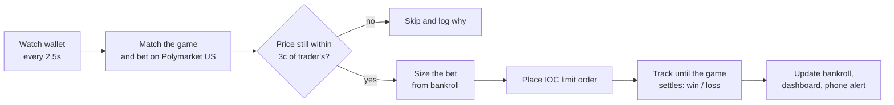

# Polymarket Copy-Trading Bot

An automated trading system that watches one trader's wallet on **Polymarket International** and copies
their sports bets onto **Polymarket US** in real time, sized to my own bankroll. It has run live with real
money since November 2026, alongside several paper-trading versions used to compare strategies.

Designed by **Ryan Fotre**. The code was written with AI-assisted development (Claude Code); the strategy,
system design, risk rules and testing plan are mine.

> This is a personal research project, not financial advice. Copy trading is risky and you can lose your
> whole bankroll.

---

## The problem

Polymarket International and Polymarket US list many of the same games, but they are separate
exchanges. A profitable trader on the international site can't simply be "followed" on the US site:

- The same game has **different market IDs and formats** on each venue.
- A US market is **one contract for both teams** (a LONG side and a SHORT side), while the international
  site lists each outcome separately, so "bet on the away team" has to become "buy SHORT".
- **Prices move** in the seconds before a copy happens, and the US exchange **charges fees**, so a copy
  is only worth taking if the price is still close to what the trader paid.

## How it works



1. **Watch**: polls the international activity API for the wallet's new trades.
2. **Match**: finds the same game on Polymarket US by event slug (or by team names and date when
   codes differ), then the same bet: moneyline, spread at the same line, or total at the same line,
   and works out whether it is the LONG or SHORT side.
3. **Price check**: skips the trade if the US price is more than 3 cents worse than what the trader paid.
4. **Size**: turns the bankroll into a bet size and rounds to the market's tick and minimum quantity.
5. **Order**: sends a limit order one tick through the best price as **Immediate-or-Cancel**, so nothing
   is ever left resting on the order book.
6. **Exit**: if the trader sells, the bot sells the same fraction of its copy.
7. **Settle**: checks open markets every minute; when a game ends it records the result and updates
   the bankroll.

Anything without an exact US match (props, halves, esports, other lines) is skipped and logged with the
reason.

## Position sizing

Two strategies were tested:

| Strategy | Rule |
|---|---|
| **Flat** | Every bet is 5% of the bankroll. |
| **Tiered** | ½×, 1× or 2× of that, depending on how much money the trader put on the bet ($300 / $600 cutoffs). Bigger conviction from the trader means a bigger copy. |

Both compound: the bankroll, and so the bet size, grows and shrinks with realized profit and loss.
Deposits are tracked separately so they never count as profit.

**Backtest** (128 historical trades, Sep 30 to Nov 11, 2026, starting from $100):

| | Ending bankroll | Worst drawdown |
|---|---|---|
| Flat | $185 | $67 |
| Tiered | $262 | $53 |

On 5,000 bootstrap resamples of the same trades, tiered sizing finished ahead in **88%** of them. The
live bot uses tiered sizing. Caveat: the trader was chosen partly on this same history, so the backtest
is optimistic, and the sample of 2× bets is small.

## Testing before risking money

- **Dry-run mode** is the default. The bot does everything except place the order, so strategies can be
  compared side by side on the same live trades. Live trading needs an explicit setting change.
- **Paper bots** (flat vs. tiered, and a second wallet) run next to the live bot, each with its own state.
- **57 automated tests** using saved real market data cover market matching, LONG/SHORT mapping,
  sizing, tick rounding, fills, limits and notifications.
- A **backfill tool** replays trades the paper bots missed during downtime, so comparisons stay fair.

## Monitoring

- **Dashboard** (`localhost:4321`): bankroll, open bets, settled results, and a flat-vs-tiered comparison.
- **Phone alerts** through [ntfy](https://ntfy.sh): every bet, every result, and an urgent alert if the
  live bot stops checking in.
- **Safety rules**: per-game and per-order caps, a slippage limit, an optional loss limit, and an
  automatic stop if fills average more than 2.5 cents worse than the trader's price.

## Tech

TypeScript on Node.js · Polymarket US SDK (`polymarket-us`) · Polymarket data API · Zod for settings
validation · Node's built-in test runner · plain HTML dashboard.

```
src/
  watcher.ts     reads the wallet's new trades
  resolver.ts    maps an international trade to a US market and side
  pricing.ts     price check and limit price
  sizing.ts      flat and tiered sizing, compounding
  limits.ts      caps, loss limit, slippage stop
  executor.ts    dry-run or live IOC orders
  state.ts       positions, results, and trades already handled
  notify.ts      phone alerts
  index.ts       main loop
tools/           dashboard, backfill, key check, reconciliation
test/            automated tests and saved market data
```

---

## Running it yourself

You need Node.js 20+ and, for live trading, Polymarket US API keys.

```bash
npm install
cp .env.example .env     # then edit .env
npm run dry              # dry run: prints what it would do, never trades
npm test                 # run the checks
npm run dashboard        # http://localhost:4321
```

Put API keys only in `.env`, which is never committed. Live trading starts only when you set
`DRY_RUN=false` yourself; start with a small bankroll.

### Settings (`.env`)

| Setting | What it does |
|---|---|
| `TARGET_PROXY_WALLET` | The wallet to copy (from its polymarket.com profile URL). |
| `DRY_RUN` | `true` (default) never trades; `false` places real orders. |
| `USER_BANKROLL_USD` | Starting bankroll. |
| `ADDED_FUNDS_USD` | Money added (+) or withdrawn (−) later. Used for sizing, never counted as profit. |
| `SIZING_MODE` | `fixed_pct` (flat), `whale_tier` (tiered), or `whale_ratio`. |
| `PCT_PER_TRADE` | Flat bet as a fraction of bankroll (0.05 = 5%). |
| `TIER_THRESHOLDS_USD` / `TIER_MULTIPLIERS` | Tier cutoffs and multipliers for `whale_tier`. |
| `TOP_UP_WINDOW_SEC` | How long after the first buy a tier top-up is allowed. |
| `MIN_ORDER_USD` / `MAX_ORDER_USD` | Every order is kept inside this range. |
| `MAX_PER_MARKET_USD` / `MAX_PER_GAME_USD` | Most money on one market / one game. |
| `MIN_WHALE_TRADE_USD` | Ignore the trader's bets smaller than this. |
| `MAX_SLIPPAGE_CENTS` | Skip if the US price is worse than the trader's by more than this. |
| `MAX_TRADE_AGE_SEC` | Ignore trades older than this when first seen. |
| `COMPOUND_BANKROLL` | Grow and shrink bet sizes with realized profit and loss. |
| `MAX_LOSS_USD` | Stop opening bets after this much could be lost (0 = off). |
| `MAX_AVG_SLIPPAGE_CENTS` / `SLIPPAGE_MIN_FILLS` | Stop if average fills are this much worse than the trader's, after this many fills. |
| `MARKET_KINDS` | Which bets to copy: `moneyline`, `spread`, `total`, `soccer_winner`. |
| `LEAGUES` | Only these leagues (`nba`, `nfl`, ...). Empty = all. |
| `COPY_EXITS` | Copy the trader's sells. |
| `NTFY_TOPIC` | Phone alerts topic for the live bot. Empty = off. |
| `POLL_MS` / `SETTLE_CHECK_MS` | How often to check for trades / finished games. |
| `DATA_DIR` | Folder for state and logs. Live trading only runs from `data`. |

### Commands

| Command | What it does |
|---|---|
| `npm start` | Run the bot (dry or live, from `.env`) |
| `npm run dry` | Run in dry-run mode whatever `.env` says |
| `npm run dry:sized`, `dry:w9674`, `dry:w9674-sized` | Separate paper bots for strategy comparison; they can never trade |
| `npm run dashboard` | Read-only dashboard |
| `npm test` / `npm run typecheck` | Checks |
| `npx tsx tools/check-keys.ts` | Confirm API keys work (reads the balance only) |
